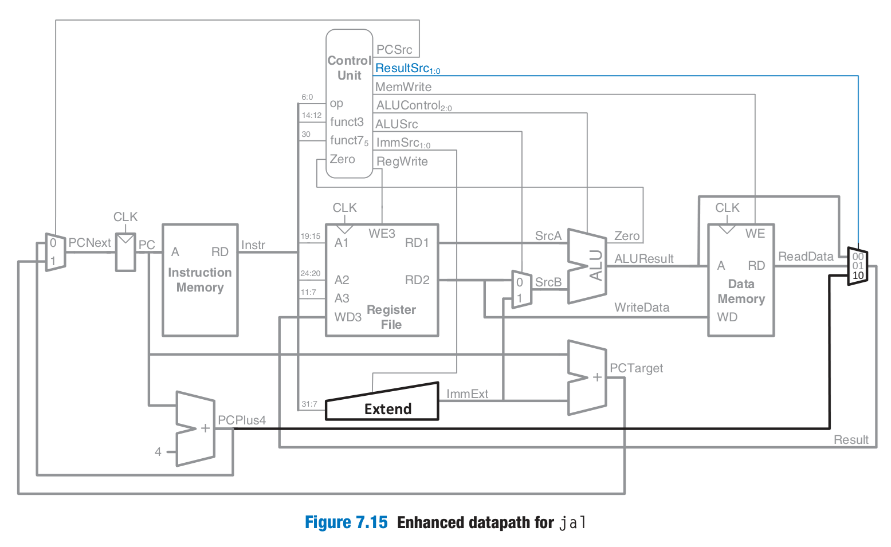
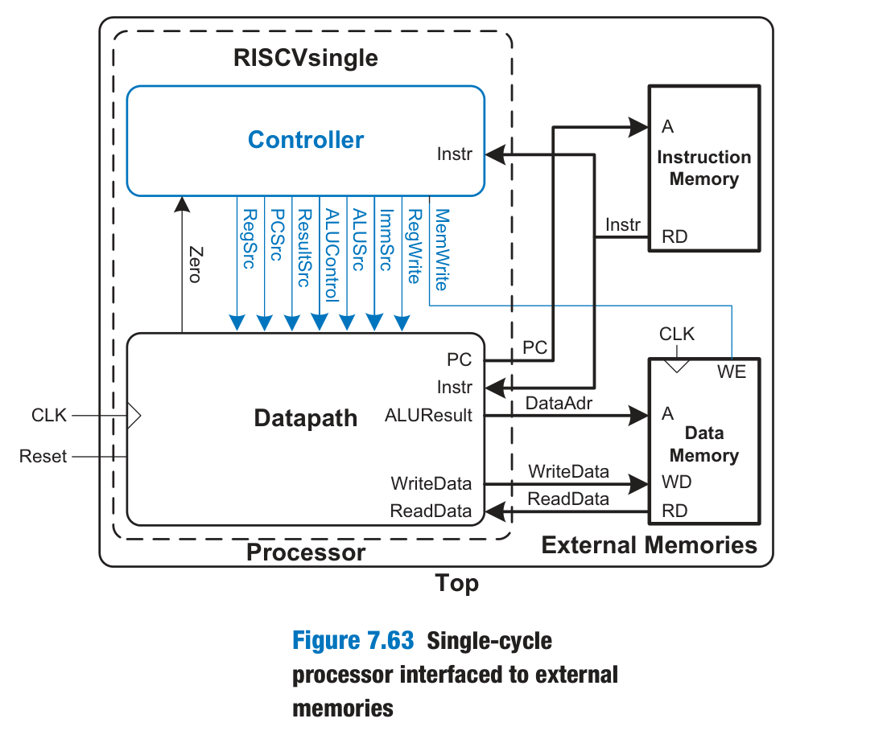
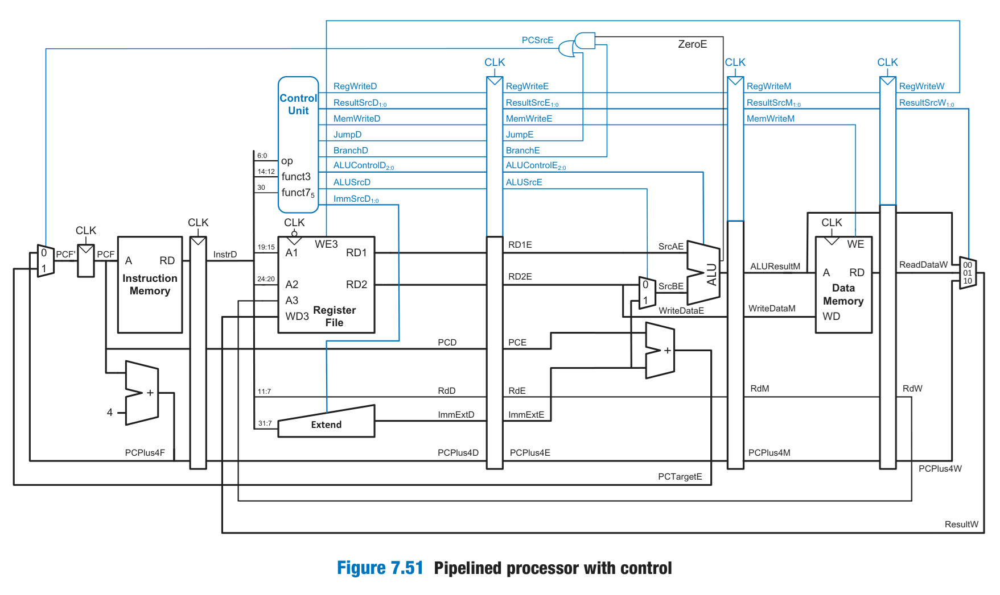
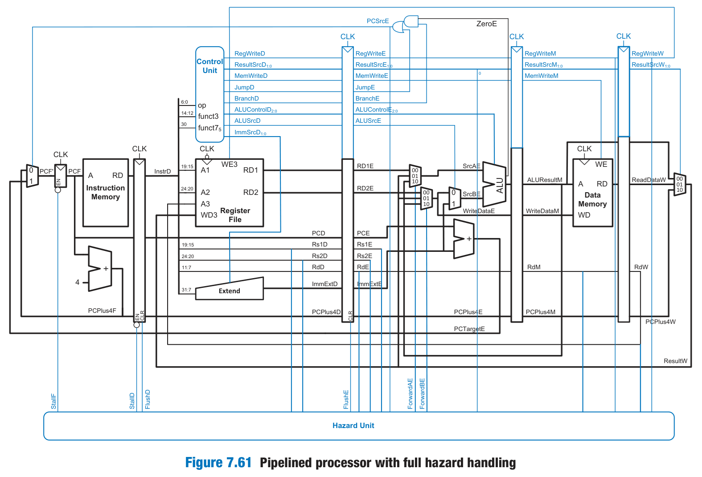
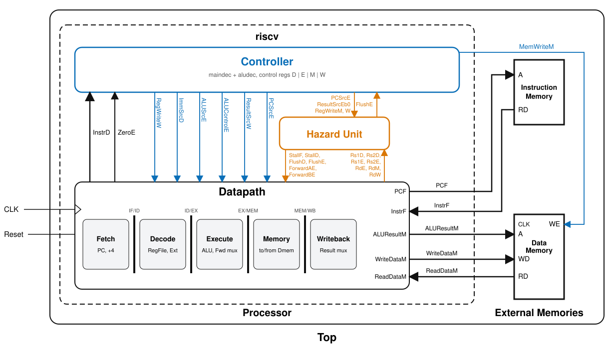

# De single-cycle a pipeline (RISC-V)

Guía de los cambios hechos para convertir el procesador RISC-V single-cycle en uno segmentado de 5 etapas (IF, ID, EX, MEM, WB) con manejo de hazards. Cada paso agrupa uno o varios commits; las correcciones menores no se detallan.

Convención de nombres: el sufijo de cada señal indica la etapa en la que vive (`F`etch, `D`ecode, `E`xecute, `M`emory, `W`riteback). Ej.: `RegWriteW` es el `RegWrite` que llega a la etapa WB.

| Paso | Qué se agrega | Commits |
|------|---------------|---------|
| 0 | Base single-cycle | `be12a76` |
| 1 | Registros de pipeline en el datapath | `fca53aa` |
| 2 | Registros de pipeline en el controller | `9ca1706` |
| 3 | Conexión en `riscv.v` | `bdf4e5e` |
| 4 | Flops con `enable` y `clear` | `ab14e98` |
| 5 | Hazard unit | `223f612`, `be83e01` |
| 6 | Hazard unit integrada en datapath, controller y top | `0a26a3b`, `90981cc`, `869f719` |

---

## Paso 0 — Base single-cycle

Punto de partida: un procesador de ciclo único con `riscvsingle`, `controller`, `datapath`, `maindec`, `aludec`, `alu`, `regfile`, `extend`, `imem`, `dmem`, etc. Soporta `lw`, `sw`, `beq`, tipo R, tipo I y `jal`.

En un solo ciclo ocurre todo: se lee la instrucción, se decodifica, se ejecuta, se accede a memoria y se escribe el resultado. El período de reloj lo limita la ruta más larga (la de `lw`).





---

## Paso 1 — Registros de pipeline en el datapath

Se divide el datapath en 5 etapas separadas por 4 registros de pipeline (se usa `flopr` con el bus concatenado):

| Registro | Contiene |
|----------|----------|
| IF/ID (`regD`) | `InstrF`, `PCF`, `PCPlus4F` |
| ID/EX (`regE`) | `RD1D`, `RD2D`, `PCD`, `RdD`, `ImmExtD`, `PCPlus4D` |
| EX/MEM (`regM`) | `ALUResultE`, `WriteDataE`, `RdE`, `PCPlus4E` |
| MEM/WB (`regW`) | `ALUResultM`, `ReadDataM`, `RdM`, `PCPlus4M` |

Cambios importantes respecto al single-cycle:

- **Renombrado por etapa** de todas las señales (`ALUResult` → `ALUResultM`, `Zero` → `ZeroE`, etc.).
- **El sumador del branch target** (`pcaddbranch`) pasó de Fetch a Execute: ahora usa `PCE + ImmExtE` y produce `PCTargetE`. El `PCSrc` que elige el siguiente PC se resuelve en EX (`PCSrcE`).
- **`Rd` viaja con la instrucción** hasta WB, para que la escritura en el register file use el `RdW` correcto y no el `Rd` de la instrucción que está en Decode.
- **El register file escribe en el flanco de bajada** (`negedge clk`), de modo que una instrucción en WB y otra en ID que lean el mismo registro en el mismo ciclo ven el valor nuevo (resuelve ese hazard sin lógica extra).



---

## Paso 2 — Registros de pipeline en el controller

Las señales de control se generan en Decode y deben acompañar a la instrucción por el pipeline. El controller ahora recibe `clk`/`reset` y tiene sus propios registros:

| Registro | Señales |
|----------|---------|
| ID/EX | `RegWrite`, `ResultSrc`, `MemWrite`, `Jump`, `Branch`, `ALUControl`, `ALUSrc` |
| EX/MEM | `RegWrite`, `ResultSrc`, `MemWrite` |
| MEM/WB | `RegWrite`, `ResultSrc` |

Cada señal se consume en la etapa donde hace falta y ya no se propaga más:

- `ImmSrcD`: Decode.
- `ALUSrcE`, `ALUControlE`: Execute.
- `PCSrcE = BranchE & ZeroE | JumpE`: Execute (antes se calculaba en el mismo ciclo que todo lo demás).
- `MemWriteM`: Memory.
- `RegWriteW`, `ResultSrcW`: Writeback.

---

## Paso 3 — Conexión en `riscv.v`

- `riscvsingle.v` se reemplaza por `riscv.v`, que conecta controller y datapath con los nuevos nombres.
- El datapath expone `InstrD` como salida: el controller decodifica `op`, `funct3` y `funct7b5` desde la instrucción **en Decode** (no la de Fetch).
- `top.v` se ajusta a los nuevos puertos (`PCF`, `InstrF`, `ALUResultM`, `WriteDataM`, `MemWriteM`, `ReadDataM`).

Hasta aquí el pipeline funciona **solo para programas sin dependencias** entre instrucciones consecutivas (sin hazards de datos ni de control).

---

## Paso 4 — Flops con `enable` y `clear`

Para poder congelar y vaciar etapas se agregan tres variantes de `flopr`:

| Módulo | Comportamiento | Uso |
|--------|----------------|-----|
| `flopenr` | Solo captura `d` si `en` | PC (`StallF`) |
| `floprc` | Pone `q = 0` si `clear` | ID/EX (`FlushE`) |
| `flopenrc` | `en` y `clear` combinados | IF/ID (`StallD` y `FlushD`) |

---

## Paso 5 — Hazard unit

Módulo nuevo `hazard.v`, puramente combinacional. Resuelve tres casos:

### 5.1 Hazards de datos por forwarding (RAW)

Si una instrucción en EX necesita un registro que una instrucción posterior (en MEM o WB) todavía no escribió, se le adelanta el valor. `ForwardAE`/`ForwardBE`:

| Valor | Fuente |
|-------|--------|
| `00` | Register file (`RD1E`/`RD2E`) |
| `01` | `ResultW` (de WB) |
| `10` | `ALUResultM` (de MEM) |

Condición: `Rs1E == RdM & RegWriteM` (tiene prioridad MEM sobre WB) y `Rs != x0`.

### 5.2 Hazard de `lw` (stall)

El dato de un `lw` recién está disponible al final de MEM, así que ni el forwarding lo salva si la instrucción siguiente lo usa. Se detecta con:

```verilog
lwStallD = ResultSrcEb0 & ((Rs1D == RdE) | (Rs2D == RdE));
```

Acción: `StallF` y `StallD` congelan PC e IF/ID, y `FlushE` inserta una burbuja en EX. Un ciclo después, el forwarding desde WB entrega el dato.

### 5.3 Hazard de control (flush)

El branch/jump se resuelve en EX, así que las 2 instrucciones siguientes ya se buscaron por error. Si `PCSrcE = 1`, `FlushD` y `FlushE` las descartan.

| Salida | Condición |
|--------|-----------|
| `StallF`, `StallD` | `lwStallD` |
| `FlushD` | `PCSrcE` |
| `FlushE` | `lwStallD \| PCSrcE` |

---

## Paso 6 — Integración de la hazard unit

Se conecta todo lo anterior:

- **Datapath**: nuevos puertos `StallF/StallD/FlushD/FlushE/ForwardAE/ForwardBE`. El PC pasa a `flopenr`, IF/ID a `flopenrc`, ID/EX a `floprc`. Se agregan dos `mux3` antes de la ALU (`faemux` para `SrcAE` y `fbemux` para `WriteDataE`, que luego pasa por el mux de `ALUSrcE`) que eligen entre el register file, `ResultW` y `ALUResultM`. Se exponen `Rs1D`, `Rs2D`, `Rs1E`, `Rs2E`, `RdE`, `RdM`, `RdW` hacia la hazard unit.
- **Controller**: el registro ID/EX pasa a `floprc` con `clear = FlushE`, y expone `RegWriteM` y `ResultSrcEb0` hacia la hazard unit (`RegWriteW` ya salía hacia el datapath).
- **`riscv.v`**: instancia `hazard` y cablea sus entradas/salidas entre controller y datapath.

Nota: al hacer flush los registros se ponen en 0, es decir, una instrucción `0x00000000`. Por eso `maindec` recibió un caso `7'b0000000` con controles en cero, para que esa "instrucción nula" no escriba registros ni memoria (y no genere `x` en simulación).




